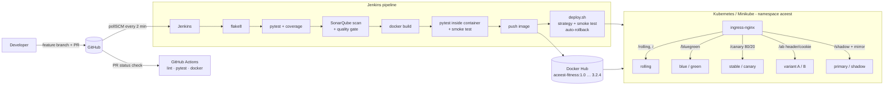

# ACEest Fitness & Gym — DevOps CI/CD Project

A Flask web application for **ACEest Fitness & Gym**, delivered through a fully automated
CI/CD pipeline: **Git/GitHub → Jenkins → Pytest → SonarQube → Docker Hub → Kubernetes**
with **rolling, blue-green, canary, A/B and shadow** deployments and automatic rollback.

| Item | Value |
|---|---|
| Current version | **3.2.4** (`aceest/version.py`) |
| Versions delivered | 1.0 · 1.1 · 1.1.2 · 2.0.1 · 2.1.2 · 2.2.1 · 2.2.4 · 3.0.1 · 3.1.2 · 3.2.4 (Git tags `v*`) |
| Tests | 238 pytest tests, 100 % line coverage |
| Container image | `<dockerhub-user>/aceest-fitness:<version>` (non-root, multi-stage) |
| CI/CD | `Jenkinsfile` (main pipeline) · `.github/workflows/pr-checks.yml` (PR status checks) |
| Kubernetes | `k8s/` — 5 deployment strategies behind one ingress |

---

## 1. Architecture



Every deployment exposes `/version` and the response headers `X-App-Version`,
`X-Deployment-Track` and `X-Served-By`, so you can see exactly which version and pod served
each request.

## 2. Repository layout

```
ACEest_Fitness.py          entry point (gunicorn ACEest_Fitness:app)
aceest/                    Flask application package
  __init__.py              application factory, configuration
  core.py                  dashboard, /health, /ready, /version, deployment headers
  programs.py              program catalogue + calorie estimation
  clients.py               client profiles, CSV export, weekly progress
  tracking.py              workouts, body metrics, BMI, summary
  auth.py / users.py       login tokens, Admin/Trainer roles
  ai_program.py            AI-style program generator
  reports.py               PDF client report
  membership.py            membership status / renewal
  db.py                    SQLite schema + in-place migrations
  validation.py errors.py  input validation, JSON errors
  middleware.py            URL prefix support for path-based ingress
tests/                     pytest suite (one file per feature)
legacy_tkinter/            the original desktop versions (functional spec)
Dockerfile                 multi-stage: base -> test -> runtime (non-root)
gunicorn.conf.py           production server settings
Jenkinsfile                CI/CD pipeline
jenkins/                   Jenkins image, plugins, docker-compose (Jenkins + SonarQube), rollback job
k8s/                       namespace + one folder per deployment strategy
scripts/                   deploy, rollback, bootstrap, demo, build-all-versions, publish
sonar-project.properties   SonarQube configuration
docs/                      submission guide, evidence checklist, report
```

## 3. Version history

Each Tkinter release in `legacy_tkinter/` was re-implemented as a web version on its own branch,
merged through a pull request and tagged.

| Tag | Branch | What it adds |
|---|---|---|
| v1.0 | `main` | Flask app, program catalogue (FL/MG/BG), dashboard, `/health`, `/version` |
| v1.1 | `feature/v1.1-client-profile` | Client profile, calorie estimation |
| v1.1.2 | `feature/v1.1.2-client-table-csv` | Client list, CSV export, adherence chart data |
| v2.0.1 | `feature/v2.0.1-sqlite-persistence` | SQLite persistence, weekly progress |
| v2.1.2 | `bugfix/v2.1.2-validation-errors` | Range validation, JSON error responses (bug-fix release) |
| v2.2.1 | `feature/v2.2.1-progress-chart` | Weekly adherence chart data |
| v2.2.4 | `feature/v2.2.4-workouts-metrics` | Workouts + exercises, body metrics, BMI, goals, summary |
| v3.0.1 | `feature/v3.0.1-production-k8s` | Readiness probe, gunicorn, URL prefixes, Kubernetes manifests, Deploy stage |
| v3.1.2 | `feature/v3.1.2-auth-ai-pdf` | Login (hashed passwords, signed tokens), AI program generator, PDF report |
| v3.2.4 | `feature/v3.2.4-membership-roles` | Membership tracking, Admin/Trainer roles |

## 4. Run locally

```powershell
python -m venv .venv
.venv\Scripts\activate                      # Linux/macOS: source .venv/bin/activate
pip install -r requirements-dev.txt
$env:ACEEST_ADMIN_PASSWORD = "ChangeMe123"  # Linux/macOS: export ACEEST_ADMIN_PASSWORD=ChangeMe123
python ACEest_Fitness.py                    # http://localhost:5000
```

### Run the tests

```powershell
pytest                                            # 238 tests
pytest --cov=aceest --cov-report=term-missing     # with coverage
flake8                                            # lint
```

## 5. Docker

```powershell
docker build -t aceest-fitness:3.2.4 .                         # runtime image (non-root)
docker run -p 5000:5000 -e ACEEST_ADMIN_PASSWORD=ChangeMe123 aceest-fitness:3.2.4

docker build --target test -t aceest-fitness:test .             # tests inside the container
docker run --rm aceest-fitness:test
```

Build and push **all versions** from their Git tags (Git Bash):

```bash
DOCKERHUB_USER=<you> scripts/build-all-versions.sh
```

## 6. CI/CD pipeline (Jenkins)

`Jenkinsfile` stages:

| # | Stage | Purpose |
|---|---|---|
| 1 | Checkout | `pollSCM('H/2 * * * *')` triggers a build on every new commit |
| 2 | Setup Python | virtualenv + dependencies, reads the app version |
| 3 | Lint | flake8 |
| 4 | Unit Tests | pytest, JUnit report, Cobertura coverage report |
| 5 | SonarQube Analysis | static analysis + coverage upload |
| 6 | Quality Gate | pipeline stops if the SonarQube quality gate fails |
| 7 | Docker Build | runtime image tagged `<version>` and `<version>-b<build>` |
| 8 | Test in Container | full pytest suite inside the `test` image + smoke test of the runtime image |
| 9 | Push to Docker Hub | `<version>`, `<version>-b<build>`, `latest` |
| 10 | Deploy to Kubernetes | `scripts/deploy.sh <strategy>` with smoke test and **automatic rollback** |
| 11 | Archive Artifacts | versioned tarball + `build-info.json` + test/coverage reports |

Parameters: `DEPLOY_STRATEGY` (rolling · blue-green · canary · canary-promote · ab · shadow · none)
and `CANARY_WEIGHT`. A second job (`jenkins/Jenkinsfile.rollback`) rolls back on demand.

Local Jenkins + SonarQube: `docker compose -f jenkins/docker-compose.yml up -d --build`
(full setup in [docs/SUBMISSION-GUIDE.md](docs/SUBMISSION-GUIDE.md)).

## 7. Kubernetes deployment strategies

All strategies live in namespace `aceest` behind **one ingress URL** (path prefixes):

| URL path | Strategy | How it works | Rollback |
|---|---|---|---|
| `/rolling`, `/` | Rolling update | `maxSurge 1`, `maxUnavailable 0`, readiness-gated | `kubectl rollout undo` |
| `/bluegreen` | Blue-green | live Service selector `color: blue/green`; preview Service for smoke tests | switch selector back (instant) |
| `/canary` | Canary | ingress-nginx `canary-weight` (default 20 %) | weight 0 + undo |
| `/ab` | A/B testing | header `X-Variant: B` or cookie `ab_variant=always` → variant B | undo variant B |
| `/shadow` | Shadow | ingress-nginx `mirror-target` copies traffic to the shadow; users only see primary | undo shadow |

```bash
minikube start --driver=docker --cpus=4 --memory=4g
minikube addons enable ingress
DOCKERHUB_USER=<you> scripts/bootstrap-k8s.sh      # creates everything
minikube tunnel        # Windows (admin terminal) / macOS (sudo) - Ubuntu: use http://$(minikube ip) instead
curl http://127.0.0.1/canary/version
curl -H "X-Variant: B" http://127.0.0.1/ab/version
scripts/demo-strategies.sh                         # evidence -> docs/evidence/
scripts/deploy.sh blue-green <you>/aceest-fitness:3.2.4
scripts/rollback.sh blue-green
```

## 8. API reference

| Method | Path | Auth | Description |
|---|---|---|---|
| GET | `/` | – | Dashboard |
| GET | `/health` · `/ready` · `/version` | – | Liveness · readiness · version/track/pod |
| GET | `/api/programs` · `/api/programs/<code>` | – | Program catalogue (FL, FL5, MG, BG) |
| GET | `/api/programs/<code>/calories?weight=` | – | Calorie estimate |
| GET/POST | `/api/clients` | – | List / create-or-update a client |
| GET | `/api/clients/export.csv` · `/api/clients/chart` | – | CSV export · adherence chart data |
| GET | `/api/clients/<name>` · `/summary` · `/bmi` | – | Profile · summary · BMI |
| GET/POST | `/api/clients/<name>/progress` | – | Weekly adherence chart / log |
| GET/POST | `/api/clients/<name>/workouts` · `/metrics` | – | Workout history · body metrics |
| POST | `/api/auth/login` · GET `/api/auth/me` | – / token | Login (returns bearer token) |
| POST | `/api/clients/<name>/ai-program` | token | AI-style weekly program |
| GET | `/api/clients/<name>/report.pdf` | token | PDF client report |
| GET/POST | `/api/clients/<name>/membership` | token / Admin | Membership status / renewal |
| GET/POST | `/api/users` | Admin | List / create users (Admin, Trainer) |

Example:

```bash
curl -X POST localhost:5000/api/clients -H "Content-Type: application/json" \
     -d '{"name":"Arun","program":"MG","age":28,"weight":75,"height":175}'
TOKEN=$(curl -s -X POST localhost:5000/api/auth/login -H "Content-Type: application/json" \
     -d '{"username":"admin","password":"ChangeMe123"}' | python -c "import json,sys;print(json.load(sys.stdin)['token'])")
curl -H "Authorization: Bearer $TOKEN" localhost:5000/api/clients/Arun/report.pdf -o Arun.pdf
```

## 9. Configuration

| Variable | Default | Purpose |
|---|---|---|
| `ACEEST_DB` | `instance/aceest_fitness.db` (`/data/...` in Docker) | SQLite file |
| `ACEEST_SECRET_KEY` | random per process | token signing key (shared via Kubernetes Secret) |
| `ACEEST_ADMIN_PASSWORD` | random, logged once | first admin account password |
| `ACEEST_TOKEN_MAX_AGE` | `28800` | token lifetime (seconds) |
| `DEPLOYMENT_TRACK` | `stable` | shown in `/version` and headers |
| `URL_PREFIX` | – | path prefix for ingress routing |
| `GUNICORN_WORKERS` / `GUNICORN_THREADS` | `2` / `2` | server concurrency |

## 10. Documentation

- [docs/SUBMISSION-GUIDE.md](docs/SUBMISSION-GUIDE.md): step-by-step setup and submission
- [docs/EVIDENCE-CHECKLIST.md](docs/EVIDENCE-CHECKLIST.md): screenshots and outputs to capture
- [docs/REPORT.md](docs/REPORT.md): project report (architecture, challenges, outcomes)
- [k8s/README.md](k8s/README.md): deployment strategy details
