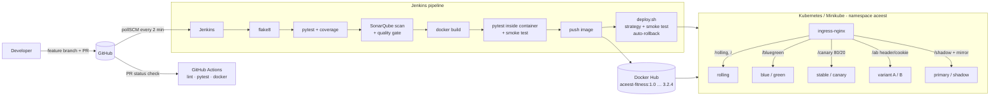

# ACEest Fitness & Gym — DevOps CI/CD Project

A Flask web application for **ACEest Fitness & Gym**, delivered through a fully automated
CI/CD pipeline: **Git/GitHub → Jenkins → Pytest → SonarQube → Docker Hub → Kubernetes**
with **rolling, blue-green, canary, A/B and shadow** deployments and automatic rollback.

| Item | Value |
|---|---|
| Current version | **3.2.4** (`aceest/version.py`) |
| Versions delivered | 1.0 · 1.1 · 1.1.2 · 2.0.1 · 2.1.2 · 2.2.1 · 2.2.4 · 3.0.1 · 3.1.2 · 3.2.4 (Git tags `v*`) |
| Tests | 238 pytest tests, 100 % line coverage |
| Container image | `<dockerhub-user>/aceest-fitness:<version>` (non-root, multi-stage) |
| CI/CD | `Jenkinsfile` (main pipeline) · `.github/workflows/pr-checks.yml` (PR status checks) |
| Kubernetes | `k8s/` — 5 deployment strategies behind one ingress |

---

## 1. Step-by-step guide

Follow the steps in order. Each step that differs by operating system shows **Windows**
(PowerShell), **macOS** (Terminal) and **Ubuntu** (Terminal). Replace anything in
`<angle brackets>` with your own value.

> **Windows:** the `scripts/*.sh` files run in **Git Bash** (installed with Git: right-click the
> project folder → *Open Git Bash here*). Everything else runs in PowerShell.
> In PowerShell, `curl` means something different, so type **`curl.exe`** instead.

### Doing it in a virtual machine (VM)

To do everything inside a VM, use an **Ubuntu** VM. Do steps VM-1 to VM-5 first, then
Steps 1–11 below inside the VM, using the **Ubuntu** commands.

**VM-1. Create the VM** (VirtualBox, VMware or Hyper-V):

| Setting | Value |
|---|---|
| OS | Ubuntu 22.04 or 24.04 **Desktop**, 64-bit |
| CPUs | **4** (6 if possible) |
| RAM | **12 GB** (10 GB minimum: Jenkins, SonarQube and Minikube all run at once) |
| Disk | **60 GB** |
| Network | NAT (the default) |

The host computer needs at least 16 GB RAM, and virtualization (VT-x / AMD-V) must be enabled
in its BIOS.

**VM-2. Install Ubuntu and update it.** Open Terminal with Ctrl+Alt+T:
```bash
sudo apt update && sudo apt upgrade -y
sudo apt install -y git curl unzip
```
In VirtualBox, also run Devices → *Insert Guest Additions CD* and reboot. This gives you copy and
paste and a resizable screen. Then set Devices → Shared Clipboard → *Bidirectional*.

**VM-3. Copy the project into the VM.** Move it as a Git *bundle*, a single file that carries
every branch and tag. A zip of the folder can lose the hidden `.git` folder. On the host
computer, in the project folder:
```bash
git bundle create aceest-devops.bundle --all
```
Copy `aceest-devops.bundle` into the VM. You can use a VirtualBox shared folder, a USB stick,
or upload it to Google Drive and download it in the VM's Firefox. Then, inside the VM:
```bash
git clone ~/Downloads/aceest-devops.bundle ~/aceest-devops
cd ~/aceest-devops
for b in $(git for-each-ref --format='%(refname:strip=3)' refs/remotes/origin | grep -vx HEAD); do
  git show-ref -q --verify "refs/heads/$b" || git branch "$b" "origin/$b"
done
git checkout main
git remote remove origin          # step 8 connects your own GitHub repository instead
git branch                        # must list main + 10 version branches
git tag -l                        # must show only v1.0
```
If `git tag -l` shows more than `v1.0`, delete the extra tags (`git tag -d v1.1`, and so on),
or step 8 will fail when it creates them.

> Don't `git clone` from GitHub after the pull requests have been merged. `main` would already
> contain every version, so step 8 would have nothing left to merge.

**VM-4. Take a snapshot** of the VM (VirtualBox: Machine → Take Snapshot). If something breaks
later, you can go back to it.

**VM-5. Do Steps 1–11 inside the VM, using the Ubuntu commands.** Notes for the VM:
- After `sudo usermod -aG docker "$USER"` in Step 1, **reboot the VM**. Otherwise Docker says
  `permission denied`.
- Open the web pages in the VM's Firefox: http://localhost:5000, http://localhost:8080 (Jenkins)
  and http://localhost:9000 (SonarQube).
- In Step 9 no `minikube tunnel` is needed. The cluster URL is `http://$(minikube ip)`.
- In Step 11, the public URL is `ngrok http $(minikube ip):80` (install it with `sudo snap install ngrok`).

**Optional: open Jenkins and SonarQube from the host computer.**
- **VirtualBox (NAT):** go to Settings → Network → Advanced → Port Forwarding. Add host 8080 →
  guest 8080 and host 9000 → guest 9000, then open http://localhost:8080 on the host.
- **Bridged network:** run `hostname -I` in the VM, then open `http://<vm-ip>:8080` on the host.

**After restarting the VM:**
```bash
cd ~/aceest-devops
minikube start
docker start jenkins sonarqube
scripts/jenkins-kubeconfig.sh     # only if `minikube ip` changed; then re-upload the kubeconfig credential
```

**VM problems:**

| Problem | Fix |
|---|---|
| `permission denied ... docker.sock` | Reboot the VM after `usermod -aG docker` |
| SonarQube stops after a minute | The VM needs more RAM: 12 GB, and close other apps |
| `minikube start` fails on memory | Use `--memory=3g`, or give the VM more RAM |
| VM is very slow / "VT-x is not available" | Enable virtualization in the host BIOS. On Windows hosts, turn off *Memory integrity* (Core isolation) for VirtualBox |
| Disk full | `docker system prune -a` |

> **Windows VM instead of Ubuntu:** Docker Desktop needs *nested virtualization*. On a Hyper-V
> host, run `Set-VMProcessor -VMName <vm> -ExposeVirtualizationExtensions $true` while the VM is
> off. In VMware, tick *Virtualize Intel VT-x/EPT*. VirtualBox is unreliable for this, so use
> Ubuntu there. Then follow the Windows commands in Steps 1–11.

### Step 1: Install the tools

You need Git, Python 3.12, Docker, kubectl, Minikube and the GitHub CLI. Give Docker at
least **8 GB RAM and 4 CPUs**.

**Windows** (PowerShell as Administrator, then restart Windows):
```powershell
winget install -e --id Git.Git
winget install -e --id Python.Python.3.12
winget install -e --id Docker.DockerDesktop
winget install -e --id Kubernetes.kubectl
winget install -e --id Kubernetes.minikube
winget install -e --id GitHub.cli
```
Then open Docker Desktop → Settings → Resources → 8 GB / 4 CPUs.

**macOS** (needs [Homebrew](https://brew.sh)):
```bash
brew install git python@3.12 kubectl minikube gh
brew install --cask docker
```
Then open Docker Desktop → Settings → Resources → 8 GB / 4 CPUs. Under Settings → Advanced,
keep "Allow the default Docker socket to be used" ticked.

**Ubuntu:**
```bash
sudo apt update && sudo apt install -y git curl python3 python3-venv python3-pip gh
curl -fsSL https://get.docker.com | sudo sh
sudo usermod -aG docker "$USER"          # then log out and back in
curl -LO "https://dl.k8s.io/release/$(curl -Ls https://dl.k8s.io/release/stable.txt)/bin/linux/amd64/kubectl"
sudo install kubectl /usr/local/bin/kubectl && rm kubectl
curl -LO https://storage.googleapis.com/minikube/releases/latest/minikube-linux-amd64
sudo install minikube-linux-amd64 /usr/local/bin/minikube && rm minikube-linux-amd64
```

Check that everything is installed (all operating systems):
```bash
git --version; docker --version; docker compose version
kubectl version --client; minikube version; gh --version
docker run --rm hello-world               # prints "Hello from Docker!"
```

### Step 2: Set up Git and GitHub

```bash
git config --global user.name  "<Your Name>"
git config --global user.email "<your-github-email>"
gh auth login                             # GitHub.com -> HTTPS -> Login with a web browser
```

Create these two accounts and repositories:
- **GitHub:** an empty **public** repository named `aceest-devops`, with no README and no licence.
- **Docker Hub:** a **public** repository named `aceest-fitness`. Also create a personal access
  token with *Read & Write* access (Account settings → Personal access tokens) and save it.

### Step 3: Run the tests

Open a terminal in the project folder.

| | Windows (PowerShell) | macOS / Ubuntu |
|---|---|---|
| Create the venv | `python -m venv .venv` | `python3 -m venv .venv` |
| Activate it | `Set-ExecutionPolicy -Scope Process Bypass`<br>`.venv\Scripts\activate` | `source .venv/bin/activate` |
| Make the scripts executable | – | `chmod +x scripts/*.sh` |

Then, on all operating systems:
```bash
pip install -r requirements-dev.txt
pytest -v                                         # 238 tests pass
pytest --cov=aceest --cov-report=term-missing     # 100 % coverage
flake8                                            # no output = no lint errors
```
If `pytest` is "not recognized", the venv isn't activated. Run the activate line again, or
use `python -m pytest -v`.

### Step 4: Run the app locally

| Windows (PowerShell) | macOS / Ubuntu |
|---|---|
| `$env:ACEEST_ADMIN_PASSWORD = "ChangeMe123"`<br>`python ACEest_Fitness.py` | `export ACEEST_ADMIN_PASSWORD=ChangeMe123`<br>`python3 ACEest_Fitness.py` |

Open http://localhost:5000 (the dashboard) and http://localhost:5000/version. Press **Ctrl+C**
to stop.
- If port 5000 is busy, run it on 5050 instead: `PORT=5050` on macOS/Ubuntu, or
  `$env:PORT = "5050"` on Windows. On a Mac, AirPlay Receiver uses port 5000.
- If you can't log in as `admin` with ChangeMe123, delete the old `instance/` folder and start
  the app again.

### Step 5: Build and run the Docker image

```bash
docker build --target test -t aceest-fitness:test .
docker run --rm aceest-fitness:test               # the tests run inside the container

docker build -t aceest-fitness:3.2.4 .
docker run -d --name aceest -p 8000:5000 -e ACEEST_ADMIN_PASSWORD=ChangeMe123 aceest-fitness:3.2.4
docker ps                                         # "(healthy)" after about 30 s
docker exec aceest id                             # uid=10001(appuser), not root
curl http://localhost:8000/version                # Windows: curl.exe
docker rm -f aceest
```
If you get "container name is already in use", run `docker rm -f aceest` and try again.

### Step 6: Start Jenkins and SonarQube

```bash
docker compose -f jenkins/docker-compose.yml up -d --build    # first run takes 5-10 min
docker exec jenkins cat /var/jenkins_home/secrets/initialAdminPassword
```

**SonarQube** at http://localhost:9000:
1. Log in as `admin` / `admin` and set a new password.
2. Go to My Account → Security → Generate Token (name `jenkins`, type *Global Analysis*) and save the token.
3. Go to Administration → Configuration → Webhooks → Create, with URL `http://jenkins:8080/sonarqube-webhook/`.

**Jenkins** at http://localhost:8080:
1. Paste the unlock password, choose **Install suggested plugins** and create your admin user.
2. Go to Manage Jenkins → System and set these:
   - **Global properties → Environment variables:** add `DOCKERHUB_USER` = `<your Docker Hub username>`.
   - **SonarQube servers:** set Name `SonarQube` and URL `http://sonarqube:9000`. For the
     token, add a *Secret text* credential containing the SonarQube token, with ID `sonarqube-token`.
3. Go to Manage Jenkins → Credentials → Add Credentials. Choose *Username with password*: your
   Docker Hub username, with the Docker Hub token as the password. Set the ID to `dockerhub`.

### Step 7: Start Minikube and connect it to Jenkins

```bash
minikube start --driver=docker --cpus=4 --memory=4g
minikube addons enable ingress
kubectl config current-context                    # must print: minikube
```
In Git Bash on Windows, or Terminal on macOS/Ubuntu:
```bash
scripts/jenkins-kubeconfig.sh                     # writes jenkins/kubeconfig-minikube
ACEEST_ADMIN_PASSWORD='ChangeMe123' scripts/ensure-secret.sh
```
Then in Jenkins go to Credentials → Add Credentials → *Secret file*. Upload
`jenkins/kubeconfig-minikube` with ID `kubeconfig`.

### Step 8: Push to GitHub through pull requests

The publish script pushes `main`, then opens one pull request per version and merges it in order
(v1.1 → … → v3.2.4 → docs). It tags each release as it goes.

| Windows (PowerShell) | macOS / Ubuntu |
|---|---|
| `Set-ExecutionPolicy -Scope Process Bypass`<br>`.\scripts\publish-to-github.ps1 -RepoUrl https://github.com/<github-user>/aceest-devops.git` | `scripts/publish-to-github.sh https://github.com/<github-user>/aceest-devops.git` |

When the script pauses after pushing `main`, set up the Jenkins jobs:
1. Create the pipeline job: Jenkins → New Item → `aceest-fitness` → **Pipeline**. Choose
   *Pipeline script from SCM* → Git, enter your repository URL, set Branch `*/main` and Script
   Path `Jenkinsfile`, then Save.
2. Click **Build Now**. When the build is green, press Enter in the terminal.
3. After each merge the script pauses again. Wait for that Jenkins build, then press Enter.
4. Create a second job named `aceest-rollback` with the same repository and Script Path
   `jenkins/Jenkinsfile.rollback`.

To do it by hand instead: on GitHub open a pull request with **base: `main`** and
**compare: `feature/v1.1-client-profile`**, then merge it. Repeat for each next branch, in the
order of the [version history](#4-version-history), ending with `docs/project-documentation`.
After each merge, tag the release:
`git fetch origin; git tag -a v1.1 origin/main -m "Release v1.1"; git push origin v1.1`.

### Step 9: Deploy every strategy

The `rolling` strategy deploys automatically. For each of the other four, open Jenkins →
`aceest-fitness` → **Build with Parameters**, set `DEPLOY_STRATEGY`, and build. Do this for
`blue-green`, `canary`, `ab` and `shadow`.

```bash
kubectl -n aceest get deploy,svc,ingress,pods -o wide
```

Find the cluster URL for your system:

| Windows | macOS | Ubuntu |
|---|---|---|
| Run `minikube tunnel` in an **Administrator** PowerShell and leave it open. The URL is `http://127.0.0.1`. | Run `minikube tunnel` in a new Terminal tab (it asks for your password) and leave it open. The URL is `http://127.0.0.1`. | No tunnel is needed. The URL is `http://$(minikube ip)`. |

```bash
URL=http://127.0.0.1                              # Ubuntu: URL=http://$(minikube ip)
curl $URL/version                                 # rolling
curl $URL/bluegreen/version                       # blue-green
for i in $(seq 1 20); do curl -s $URL/canary/version; echo; done   # roughly 80 % stable, 20 % canary
curl -H "X-Variant: B" $URL/ab/version            # A/B testing: variant B
curl $URL/shadow/version                          # shadow: users only see the primary
kubectl -n aceest logs deploy/aceest-shadow-new --tail=5           # requests mirrored to the shadow
BASE_URL=$URL scripts/demo-strategies.sh         # saves everything to docs/evidence/
```

### Step 10: Test rollback

```bash
ROLLOUT_TIMEOUT=60s scripts/deploy.sh rolling <dockerhub-user>/aceest-fitness:does-not-exist
#   -> prints "ROLLING BACK ..." and the previous version keeps serving
kubectl -n aceest rollout history deployment/aceest-rolling
scripts/rollback.sh blue-green                    # manual rollback (instant selector switch)
```
You can also run a manual rollback from Jenkins: `aceest-rollback` → Build with Parameters →
`blue-green`.

### Step 11: Collect the evidence and submit

1. Export the SonarQube report:
   ```bash
   SONAR_TOKEN=<sonarqube-token> scripts/sonar-report.sh       # docs/evidence/sonarqube-report.md
   ```
2. Take the screenshots listed in [docs/EVIDENCE-CHECKLIST.md](docs/EVIDENCE-CHECKLIST.md) and
   save them in `docs/evidence/`. Use Win+Shift+S on Windows, Cmd+Shift+4 on macOS, or the
   PrtSc key on Ubuntu.
3. Commit the evidence through one more pull request:
   ```bash
   git checkout main && git pull                  # PowerShell: use ; instead of &&
   git checkout -b docs/execution-evidence
   git add docs/evidence
   git commit -m "docs: execution evidence"
   git push -u origin docs/execution-evidence
   gh pr create --base main --title "docs: execution evidence" --body "Screenshots and outputs"
   gh pr merge --merge
   ```
4. Optional public URL: run `ngrok http 80` while `minikube tunnel` is running. On Ubuntu, run
   `ngrok http $(minikube ip):80` instead.
5. Fill in your name, ID and screenshots in `docs/ACEest_DevOps_Report.docx`. Then submit the
   report, your GitHub repository URL, your Docker Hub repository URL and the endpoint URL.

### After a restart

```bash
# start Docker Desktop first (Windows/macOS), then:
minikube start
docker start jenkins sonarqube
```
If Minikube's IP changed, re-run `scripts/jenkins-kubeconfig.sh` and upload the new
`kubeconfig` credential to Jenkins.

### Troubleshooting

| Problem | Fix |
|---|---|
| `pytest` / `flake8` not recognized | Activate the venv (step 3) or use `python -m pytest` |
| `running scripts is disabled` (Windows) | `Set-ExecutionPolicy -Scope Process Bypass` |
| `python: command not found` (macOS/Ubuntu) | Use `python3` |
| `permission denied` running a script | `chmod +x scripts/*.sh` |
| Port 5000 already in use | Use port 5050 (step 4) or `-p 8000:5000` for Docker |
| SonarQube stops after a minute | Give Docker 8 GB RAM |
| Jenkins: `DOCKERHUB_USER is not set` | Step 6, Jenkins point 2 |
| Quality Gate stage waits forever | The SonarQube webhook is missing (step 6, SonarQube point 3) |
| Deploy stage can't reach Kubernetes | Re-run `scripts/jenkins-kubeconfig.sh` and re-upload `kubeconfig` |
| Pods in `ImagePullBackOff` | The image isn't on Docker Hub yet, or the repository is private |
| `[safety] kubectl context is ...` | `kubectl config use-context minikube` |
| `http://127.0.0.1` doesn't answer | `minikube tunnel` must be running (Windows/macOS) |

Each phase is explained in more detail in [docs/SUBMISSION-GUIDE.md](docs/SUBMISSION-GUIDE.md).

---

## 2. Architecture



Every deployment exposes `/version` and the response headers `X-App-Version`,
`X-Deployment-Track` and `X-Served-By`, so you can see exactly which version and pod served
each request.

## 3. Repository layout

```
ACEest_Fitness.py          entry point (gunicorn ACEest_Fitness:app)
aceest/                    Flask application package
  __init__.py              application factory, configuration
  core.py                  dashboard, /health, /ready, /version, deployment headers
  programs.py              program catalogue + calorie estimation
  clients.py               client profiles, CSV export, weekly progress
  tracking.py              workouts, body metrics, BMI, summary
  auth.py / users.py       login tokens, Admin/Trainer roles
  ai_program.py            AI-style program generator
  reports.py               PDF client report
  membership.py            membership status / renewal
  db.py                    SQLite schema + in-place migrations
  validation.py errors.py  input validation, JSON errors
  middleware.py            URL prefix support for path-based ingress
tests/                     pytest suite (one file per feature)
legacy_tkinter/            the original desktop versions (functional spec)
Dockerfile                 multi-stage: base -> test -> runtime (non-root)
gunicorn.conf.py           production server settings
Jenkinsfile                CI/CD pipeline
jenkins/                   Jenkins image, plugins, docker-compose (Jenkins + SonarQube), rollback job
k8s/                       namespace + one folder per deployment strategy
scripts/                   deploy, rollback, bootstrap, demo, build-all-versions, publish
sonar-project.properties   SonarQube configuration
docs/                      submission guide, evidence checklist, report
```

## 4. Version history

Each Tkinter release in `legacy_tkinter/` was re-implemented as a web version on its own branch,
merged through a pull request and tagged.

| Tag | Branch | What it adds |
|---|---|---|
| v1.0 | `main` | Flask app, program catalogue (FL/MG/BG), dashboard, `/health`, `/version` |
| v1.1 | `feature/v1.1-client-profile` | Client profile, calorie estimation |
| v1.1.2 | `feature/v1.1.2-client-table-csv` | Client list, CSV export, adherence chart data |
| v2.0.1 | `feature/v2.0.1-sqlite-persistence` | SQLite persistence, weekly progress |
| v2.1.2 | `bugfix/v2.1.2-validation-errors` | Range validation, JSON error responses (bug-fix release) |
| v2.2.1 | `feature/v2.2.1-progress-chart` | Weekly adherence chart data |
| v2.2.4 | `feature/v2.2.4-workouts-metrics` | Workouts + exercises, body metrics, BMI, goals, summary |
| v3.0.1 | `feature/v3.0.1-production-k8s` | Readiness probe, gunicorn, URL prefixes, Kubernetes manifests, Deploy stage |
| v3.1.2 | `feature/v3.1.2-auth-ai-pdf` | Login (hashed passwords, signed tokens), AI program generator, PDF report |
| v3.2.4 | `feature/v3.2.4-membership-roles` | Membership tracking, Admin/Trainer roles |

## 5. CI/CD pipeline (Jenkins)

`Jenkinsfile` stages:

| # | Stage | Purpose |
|---|---|---|
| 1 | Checkout | `pollSCM('H/2 * * * *')` triggers a build on every new commit |
| 2 | Setup Python | virtualenv + dependencies, reads the app version |
| 3 | Lint | flake8 |
| 4 | Unit Tests | pytest, JUnit report, Cobertura coverage report |
| 5 | SonarQube Analysis | static analysis + coverage upload |
| 6 | Quality Gate | pipeline stops if the SonarQube quality gate fails |
| 7 | Docker Build | runtime image tagged `<version>` and `<version>-b<build>` |
| 8 | Test in Container | full pytest suite inside the `test` image + smoke test of the runtime image |
| 9 | Push to Docker Hub | `<version>`, `<version>-b<build>`, `latest` |
| 10 | Deploy to Kubernetes | `scripts/deploy.sh <strategy>` with smoke test and **automatic rollback** |
| 11 | Archive Artifacts | versioned tarball + `build-info.json` + test/coverage reports |

Parameters: `DEPLOY_STRATEGY` (rolling · blue-green · canary · canary-promote · ab · shadow · none)
and `CANARY_WEIGHT`. A second job (`jenkins/Jenkinsfile.rollback`) rolls back on demand.

Local Jenkins + SonarQube: `docker compose -f jenkins/docker-compose.yml up -d --build`
(full setup in [docs/SUBMISSION-GUIDE.md](docs/SUBMISSION-GUIDE.md)).

## 6. Kubernetes deployment strategies

All strategies live in namespace `aceest` behind **one ingress URL** (path prefixes):

| URL path | Strategy | How it works | Rollback |
|---|---|---|---|
| `/rolling`, `/` | Rolling update | `maxSurge 1`, `maxUnavailable 0`, readiness-gated | `kubectl rollout undo` |
| `/bluegreen` | Blue-green | live Service selector `color: blue/green`; preview Service for smoke tests | switch selector back (instant) |
| `/canary` | Canary | ingress-nginx `canary-weight` (default 20 %) | weight 0 + undo |
| `/ab` | A/B testing | header `X-Variant: B` or cookie `ab_variant=always` → variant B | undo variant B |
| `/shadow` | Shadow | ingress-nginx `mirror-target` copies traffic to the shadow; users only see primary | undo shadow |

```bash
minikube start --driver=docker --cpus=4 --memory=4g
minikube addons enable ingress
DOCKERHUB_USER=<you> scripts/bootstrap-k8s.sh      # creates everything
minikube tunnel        # Windows (admin terminal) / macOS (sudo) - Ubuntu: use http://$(minikube ip) instead
curl http://127.0.0.1/canary/version
curl -H "X-Variant: B" http://127.0.0.1/ab/version
scripts/demo-strategies.sh                         # evidence -> docs/evidence/
scripts/deploy.sh blue-green <you>/aceest-fitness:3.2.4
scripts/rollback.sh blue-green
```

## 7. API reference

| Method | Path | Auth | Description |
|---|---|---|---|
| GET | `/` | – | Dashboard |
| GET | `/health` · `/ready` · `/version` | – | Liveness · readiness · version/track/pod |
| GET | `/api/programs` · `/api/programs/<code>` | – | Program catalogue (FL, FL5, MG, BG) |
| GET | `/api/programs/<code>/calories?weight=` | – | Calorie estimate |
| GET/POST | `/api/clients` | – | List / create-or-update a client |
| GET | `/api/clients/export.csv` · `/api/clients/chart` | – | CSV export · adherence chart data |
| GET | `/api/clients/<name>` · `/summary` · `/bmi` | – | Profile · summary · BMI |
| GET/POST | `/api/clients/<name>/progress` | – | Weekly adherence chart / log |
| GET/POST | `/api/clients/<name>/workouts` · `/metrics` | – | Workout history · body metrics |
| POST | `/api/auth/login` · GET `/api/auth/me` | – / token | Login (returns bearer token) |
| POST | `/api/clients/<name>/ai-program` | token | AI-style weekly program |
| GET | `/api/clients/<name>/report.pdf` | token | PDF client report |
| GET/POST | `/api/clients/<name>/membership` | token / Admin | Membership status / renewal |
| GET/POST | `/api/users` | Admin | List / create users (Admin, Trainer) |

Example:

```bash
curl -X POST localhost:5000/api/clients -H "Content-Type: application/json" \
     -d '{"name":"Arun","program":"MG","age":28,"weight":75,"height":175}'
TOKEN=$(curl -s -X POST localhost:5000/api/auth/login -H "Content-Type: application/json" \
     -d '{"username":"admin","password":"ChangeMe123"}' | python3 -c "import json,sys;print(json.load(sys.stdin)['token'])")   # Windows Git Bash: python
curl -H "Authorization: Bearer $TOKEN" localhost:5000/api/clients/Arun/report.pdf -o Arun.pdf
```

## 8. Configuration

| Variable | Default | Purpose |
|---|---|---|
| `ACEEST_DB` | `instance/aceest_fitness.db` (`/data/...` in Docker) | SQLite file |
| `ACEEST_SECRET_KEY` | random per process | token signing key (shared via Kubernetes Secret) |
| `ACEEST_ADMIN_PASSWORD` | random, logged once | first admin account password |
| `ACEEST_TOKEN_MAX_AGE` | `28800` | token lifetime (seconds) |
| `DEPLOYMENT_TRACK` | `stable` | shown in `/version` and headers |
| `URL_PREFIX` | – | path prefix for ingress routing |
| `GUNICORN_WORKERS` / `GUNICORN_THREADS` | `2` / `2` | server concurrency |

## 9. Documentation

- [docs/SUBMISSION-GUIDE.md](docs/SUBMISSION-GUIDE.md): step-by-step setup and submission
- [docs/EVIDENCE-CHECKLIST.md](docs/EVIDENCE-CHECKLIST.md): screenshots and outputs to capture
- [docs/REPORT.md](docs/REPORT.md): project report (architecture, challenges, outcomes)
- [k8s/README.md](k8s/README.md): deployment strategy details
